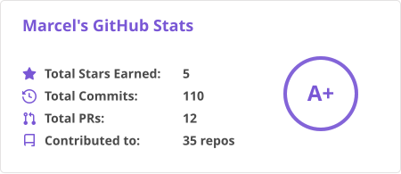
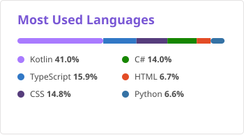

<!-- ====================================================================== -->
<!-- 🍎 REPOSITÓRIO PESSOAL DE MARCEL FLORENTINO ("MAÇÃ") • PROFILE README  -->
<!-- ====================================================================== -->

<table align="center" border="0">
  <tr>
    <td width="65%" valign="top">
      <h2>
        
        Olá, mundo!  Me chamo Marcel ("Maçã" 🍎) 
        
      </h2>
      

        &emsp;&emsp;&emsp;Entusiasta incansável da ciência da computação, apaixonado pela <strong>física dos dados</strong> (desde o pulso elétrico da tecla no hardware até os ponteiros de memória no silício) e viciado em desvendar a mecânica real por trás de cada byte.
      

      

        
        
        
         
        
        
        
      

      ────────────────────────────────────────────────────
      

        ⏳ <strong>Progress:</strong>
         
        <code>{ ████████████████████████████_________________________________ }</code> <strong>42.9%</strong>
        
      

      ────────────────────────────────────────────────────
      

        🎯 <strong>Passatempos & Paixões:</strong>
         
        🧩 <code>LeetCode (C/C++)</code> &nbsp;•&nbsp; 📝 <code>Elaboração de Listas de Exercícios</code>
         
        👨‍🏫 <code>Lecionar Estruturas de Dados</code> &nbsp;•&nbsp; 🏛️ <code>História da Computação</code>
      

      

        💡 <em>"A física dos dados molda realidades que só o ser humano é capaz de abstrair e criar." - Marcel Florentino "Maçã 🍎"</em>
      

      

    </td>
    <td width="38%" align="center" valign="middle">
      
        
      <em>#CodingFromHome • Codando & música 🎧</em>
        
      <!-- Bloco 1 (Figma): Player Spotify em Bloco -->
      
       
      <!-- Bloco 2 (Figma): Barra de Reprodução Alinhada -->
      <code>▶ 01:28 ━━━━━●───────────── 03:05 🔊</code>
    </td>
  </tr>
</table>

---

### 🧠 Quem Sou Eu & Meus Grandes Sonhos na Computação

> 💡 *"Programar não é sobre escrever linhas de código rápido; é sobre entender profundamente o que cada byte e cada ponteiro estão fazendo na memória."*

* 🎓 **Formação Acadêmica:** Bacharelando em **Engenharia de Software** pela [Universidade Estácio de Sá](https://estacio.br/).
* ⚡ **A Obsessão por C, C++ & Baixo Nível:** Sou apaixonado pela elegância das linguagens que dialogam perto do processador. Entender a diferença física entre **Stack vs Heap**, manusear ponteiros com rigor cirúrgico e resolver desafios de lógica algorítmica no **LeetCode** são meus passatempos favoritos de final de semana. Meu objetivo é me tornar um especialista de nível de referência nessas tecnologias.
* 👨‍🏫 **A Vocação da Licenciatura & Docência:** Carrego no peito um amor gigantesco pela arte de ensinar. Meu maior sonho acadêmico para o futuro é me tornar **Professor Catedrático de Estruturas de Dados & Algoritmos**, ensinando listas encadeadas, árvores binárias, ponteiros e grafos de forma viva, prática e humana para inspirar novas gerações.
* ☕ **A Visão do Arquiteto Java & Enterprise:** Focado em projetar sistemas corporativos de grande porte com maestria. Domino os princípios **SOLID**, **Clean Architecture** e **Design Patterns (GoF)** para criar códigos desacoplados, sustentáveis e testáveis. No ecossistema **Java + Spring Boot**, construo microsserviços resilientes e escaláveis, integrados a APIs robustas e frontends reativos (**Angular / React**). Para mim, arquitetura corporativa é a arte de construir soluções preparadas para os próximos 10 anos.
* 🤖 **Engenharia Aumentada por IA & Pair Programming (Education Class):** Utilizo inteligências artificiais e agentes de última geração (como o **Google Antigravity**) na dinâmica de aluno e mentor sênior. Mais do que uma ferramenta de produtividade, uso o pair programming para minha **edificação técnica contínua**, dissecando a ciência, a intenção de design e os impactos na memória de cada bloco gerado. Movido pela preocupação com o futuro da programação, onde vejo muitos estudantes caírem na armadilha de usar IA apenas como atalho para copiar respostas sem raciocínio, meu propósito é **estudar e formular métodos e prompts socráticos para a educação**, preparando os alunos para serem programadores analíticos de verdade, e não meros copiadores de código.
* 🗃️ **Modelagem, UML & Rigor de Dados (A Linguagem Universal):** Apaixonado por **UML (Unified Modeling Language)** e modelagem visual. Acredito firmemente que o diagrama é a língua franca da computação: em qualquer lugar do planeta, seja no Brasil, no Japão ou no Vale do Silício, ao bater o olho em um diagrama de fluxo ou de classes bem estruturado, qualquer engenheiro compreende o sistema imediatamente. Código é apenas uma parte da entrega; compreender a fundo a regra de negócio e a dinâmica dos fluxos antes de escrever um único `printf` é o verdadeiro divisor de águas entre um digitador de código e um engenheiro de software. Especialista em modelagem relacional de alta integridade com **PostgreSQL** e documentação visual moderna com **Mermaid.js** (Classes, Casos de Uso, Sequência e Arquitetura).

---

###  My Github Stats:

|  |  |
| ------------- | ------------- |

---

###  👨‍💻 My Languages and Tools:

  <!-- ⚡ Sistemas, Baixo Nível & Hardware -->
  &nbsp;
  &nbsp;
  &nbsp;
  &nbsp;
  &nbsp;
  <!-- ☕ Backend Corporativo, JVM, .NET & Mobile -->
  &nbsp;
  &nbsp;
  &nbsp;
  &nbsp;
  &nbsp;
  &nbsp;
  <!-- 🗄️ Bancos de Dados & Cloud / BaaS (Juntinhos!) -->
  &nbsp;
  &nbsp;
  &nbsp;
  <!-- 🌐 Frontend, Web & Interfaces Modernas -->
  &nbsp;
  &nbsp;
  &nbsp;
  &nbsp;
  &nbsp;
  &nbsp;
  &nbsp;
  &nbsp;
  &nbsp;
  <!-- 🛠️ Ferramentas de Engenharia, SO, IDEs & Design -->
  &nbsp;
  &nbsp;
  &nbsp;
  &nbsp;
  &nbsp;
  &nbsp;
  &nbsp;
  

---

### 🐍 Snake Contribution Game:

  

---

### 🙋‍♂️ Connect with me 

  <em>Aberto a conexões, pair programming, desafios de algoritmos e boas conversas sobre engenharia de software!</em>

<table>
  <tr>
    
    
    
    
  </tr> 
</table>
─────────────────────────────────────────────────────────────────────────────────────

  <em>"A simplicidade é pré-requisito para a confiabilidade."</em> - <strong>Edsger W. Dijkstra</strong>

